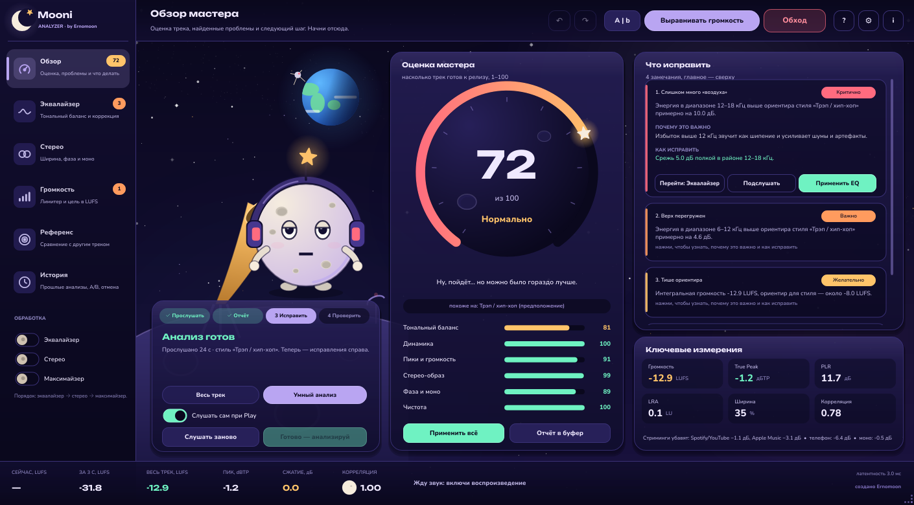

# Mooni Analyzer

**Мастеринг-ассистент VST3 с характером.** Создано **Ernomoon**.

Mooni живёт на маленькой луне — **Лунной слуховой станции «Ухо-1»**, — которая вращается вокруг твоего мастер-канала и слушает Землю (твой DAW). Он измеряет реальный звук, честно говорит, что не так, предлагает исправления и сам умеет их применить: EQ, стерео и громкость. А ещё он злится на плохие миксы и взрывается от восторга на отличных.



---

## Разделы

Навигация — слева. У каждого раздела есть короткое пояснение, а рядом — число найденных в нём проблем.

| Раздел | Что там |
|---|---|
| **Обзор** | оценка 1–100, список «Что исправить» (с уровнем важности), ключевые измерения, шаги «Прослушать → Отчёт → Исправить → Проверить» |
| **Эквалайзер** | 8-полосный параметрический EQ (стерео / Mid / Side), спектр микса, ориентир стиля и рекомендованная кривая |
| **Стерео** | ширина в 4 полосах, вектороскоп, корреляция (в виде фазы Луны), моно-проверка, баланс |
| **Громкость** | максимайзер: True-Peak лимитер + мягкий клиппер; цель в LUFS → «1 · Рассчитать» → «2 · Применить» → «3 · Подогнать» |
| **Референс** | необязательный трек для сравнения баланса, громкости и ширины |
| **История** | все прослушивания с настройками, сравнение, A/B, отмена шагов |

Под навигацией — переключатели модулей (Эквалайзер, Стерео, Максимайзер). Вверху справа — отмена/возврат, A/B, «Выравнивать громкость», **Обход** (bypass всей обработки), справка «?» (F1), настройки.

Атмосфера осталась: Mooni живёт на маленькой луне, которая вращается вокруг твоего мастер-канала и слушает Землю (твой DAW). При Обходе луна уходит в тень и Mooni засыпает.

### Mooni
Круглый лунёныш с кратерами-веснушками, огромными наушниками и антенной со звездой: её цвет — его настроение. Он полностью векторный и анимируется процедурно: моргает, дышит, парит в низкой гравитации, следит глазами за курсором, кивает в такт битам (детектор атак), перелетает в каждый раздел по дуге, а в Эквалайзере подглядывает из-за панели.

Более 35 реакций, привязанных к **реальным событиям**: начало прослушивания, «понял характер», отчёт (взрыв головы при ≥ 92, восторг, «ну, пойдёт…», раздражение, ярость с паром из наушников или отвращение), главная проблема (трясётся от баса, закрывает уши от резкого верха, получает «ЩЁЛК!» от клиппинга, раздваивается от фазовых проблем, сплющивается от пересжатия), перегрузки во время прослушивания, тишина, байпас, применение исправлений, улучшение (+N — танцует) или ухудшение (−N — фейспалм) оценки, референс, тычки (после 10 тычков он прячется). Реакции хранятся в таблице `ReactionLibrary` (`Source/gui/MooniCharacter.cpp`): новую реакцию можно добавить одной записью.

---

## Что реально измеряется

Всё считается из звука, который проходит через плагин, в отдельном потоке (аудиопоток только пишет в lock-free FIFO):

- **Громкость:** Momentary / Short-term / Integrated LUFS и LRA по ITU-R BS.1770-4 / EBU R128 / Tech 3342 (K-взвешивание для любой частоты дискретизации, гейтинг).
- **Пики:** sample peak, **True Peak** (4× полифазная интерполяция), межсэмпловые перегрузки, PLR, крест-фактор, микродинамика, «удар» (атаки).
- **Клиппинг:** серии одинаковых сэмплов у пикового уровня; «плоские вершины» ниже пика (следы клиппинга в миксе).
- **Спектр:** долгосрочный спектр (FFT 4096) в полосах 1/6 и 1/24 октавы, сравнение с ориентиром стиля или референса, узкие резонансы, инфранизкий гул, DC.
- **Стерео:** корреляция, ширина (Side/Mid), баланс Л/П, потеря в моно — всё по 4 полосам (кроссоверы Linkwitz-Riley), доля времени в противофазе.
- **Перенос:** сколько убавят Spotify/YouTube/Apple Music, потеря громкости на телефоне, в моно.

Там, где вывод — оценка, а не измерение (насыщение, «пространство», маскировка), карточка помечена как **«оценка»**.

### Оценка 1–100
Шесть подоценок с весами: тональный баланс 25%, динамика 17%, пики и громкость 18%, стерео-образ 15%, фаза и моно 13%, чистота 12%. Серьёзные проблемы ограничивают итог (например, сильная перегрузка — не выше 72). Оценка **учитывает стиль**: профиль задаёт ожидаемый баланс, плотность и громкость (трэп на −7 LUFS не штрафуется за то, что он громче поп-трека). Профиль определяется автоматически (и честно помечается как предположение) или выбирается в настройках.

### Два режима анализа
- **Весь трек** — слушает, пока играет; когда характер микса понятен, говорит: *«Я уже понял характер твоего микса. Можешь продолжать воспроизведение или остановить его, чтобы получить полный анализ.»* Полный отчёт — после остановки.
- **Умный анализ** — сыграй самый характерный кусок; готовность определяется не таймером, а **сходимостью**: стабильностью громкости, формы спектра и ширины стерео за последние секунды (минимум 8 с). Отчёт появляется сразу и уточняется, если играешь дальше.

---

## Обработка

- **EQ:** 8 полос (колокол, полки, срезы, режекция), для каждой — канал *Стерео / Mid / Side*. Плавные параметры, без щелчков; выключенный EQ — бит-в-бит прозрачен. Рекомендация показывается пунктиром поверх твоей кривой и **не меняет звук**, пока не нажмёшь «Применить рекомендации».
- **Стерео:** 4 полосы ширины 0–200%, перетаскиваемые кроссоверы, баланс. Расщепляется только Side, Mid проходит через такой же all-pass, поэтому при 100% сигнал фазово-когерентен и АЧХ ровная (проверено тестом).
- **Пресс:** драйв → мягкий клиппер (4× передискретизация) → look-ahead лимитер с **8×** детектором True Peak. Латентность постоянная (~3 мс при 48 кГц) и сообщается хосту.
- **Расчёт громкости:** кнопка «Рассчитать» прогоняет самые громкие прослушанные фрагменты через тот же самый пресс офлайн и находит драйв для цели в LUFS, а заодно показывает цену: среднее/95%/максимальное сжатие. Если цель достижима только «раздавив» трек — Mooni предложит безопасную цель; если недостижима вовсе — скажет, где потолок. После применения — «Подогнать по факту» по реально измеренной громкости.

### Ещё
- **Выравнивать громкость** — при Обходе оригинал выравнивается по громкости с обработкой (громче ≠ лучше).
- **Подслушать** — в карточке проблемы: слушать только проблемный диапазон частот. Alt+клик по кратерёнку — то же для полосы EQ.
- **Моно-проверка / Только Side**, **Слушать референс** (с выравниванием громкости).
- **Журнал:** каждое прослушивание с настройками; «Оригинал» хранится всегда; сравнение «оригинал / выбранный шаг / последний»; возврат настроек любого шага.
- **Undo/Redo** (Ctrl+Z / Ctrl+Shift+Z), **A/B** слоты, **отчёт в буфер обмена** текстом.
- Состояние (настройки, журнал, референс, A/B) сохраняется в проекте.
- Окно масштабируется (900–1800 px), есть режим «меньше анимации».

---

## Сборка

Нужно: CMake ≥ 3.22, компилятор C++17 (Windows: Visual Studio 2022). JUCE 8.0.4 скачивается автоматически (или положите его в `external/JUCE`).

```bash
cmake -S . -B build -DCMAKE_BUILD_TYPE=Release
cmake --build build --config Release --target MooniAnalyzer_VST3 MooniAnalyzer_Standalone MooniTests
build/MooniTests_artefacts/Release/MooniTests      # тесты DSP и анализа
```

### Windows-установщик через GitHub Actions
Workflow `.github/workflows/build-windows.yml` на `windows-2022`: собирает тесты и запускает их, собирает VST3 + Standalone, проверяет наличие файлов, собирает установщик Inno Setup и выкладывает всё в Artifacts (а при пуше тега `v*` — ещё и в GitHub Release).

1. Создайте пустой репозиторий на GitHub (без README).
2. В папке проекта:
   ```bash
   git init
   git add .
   git commit -m "Mooni Analyzer 1.0.0"
   git branch -M main
   git remote add origin https://github.com/<ваш-логин>/MooniAnalyzer.git
   git push -u origin main
   ```
3. Секреты не нужны. Если Actions выключены — включите во вкладке **Actions**.
4. Сборка стартует сама при пуше (или **Actions → Build Mooni Analyzer (Windows) → Run workflow**).
5. Откройте завершённый запуск → блок **Artifacts** → скачайте **MooniAnalyzer-Windows** (zip с `MooniAnalyzer-1.0.0-Windows-Setup.exe` и портативным VST3).
6. Для релиза: `git tag v1.0.0 && git push origin v1.0.0` — установщик появится во вкладке **Releases**.

### Установка и FL Studio
1. Запустите `MooniAnalyzer-1.0.0-Windows-Setup.exe` (нужны права администратора).
2. VST3 ставится в `C:\Program Files\Common Files\VST3\Mooni Analyzer.vst3`, Standalone — в `C:\Program Files\Ernomoon\Mooni Analyzer`.
3. FL Studio: **Options → Manage plugins → Find more plugins**. Найдите **Mooni Analyzer** (Ernomoon), отметьте звёздочкой.
4. Mixer → канал **Master** → **последний** слот → Mooni Analyzer. Нажмите Play.

---

## Проверено

- **pluginval** (Tracktion), строгость 10 — все тесты пройдены: открытие, редактор во время обработки, обработка при разных частотах и буферах, сохранение/восстановление состояния, автоматизация, потокобезопасность параметров, фаззинг параметров (`docs/pluginval-strictness10.txt`).

- 100 автоматических проверок (`Tests/TestMain.cpp`, результат — `docs/test-results.txt`): EBU Tech 3341/3342 (громкость, гейтинг, LRA) на 44.1/48/96/192 кГц, True Peak против независимой 16× интерполяции, точность и стабильность EQ под автоматизацией, бит-точная прозрачность выключенных модулей, фазовая ровность имиджера, потолок лимитера (−1.01 dBTP при цели −1), точность прогноза громкости (±0.1 LU против реального прохода), тишина/шум/синус/клиппинг/противофаза/баланс, сериализация отчётов, сквозной тест движка анализа, загрузка референса.
- Интерфейс отрисован и проверен на скриншотах (Linux, Xvfb), кириллица отображается корректно.

## Ограничения (честно)

- Анализ видит только то, что проходит через плагин: тот кусок, что вы проиграли.
- Тип сатурации или «аналоговый прибор» по звуку не определяется — только косвенные признаки, помеченные как оценка.
- Ориентиры стилей — эвристика, а не стандарт; референс — контекст, а не цель.
- 4× True Peak (как в BS.1770) может недооценивать пики контента у самой частоты Найквиста; лимитер использует 8× детектор.
- Windows-сборка и установщик собираются в GitHub Actions; в среде разработки они не собирались и не проверялись в FL Studio (см. отчёт о сборке).

---

Mooni Analyzer · создано **Ernomoon** · шрифты Nunito и Unbounded (SIL OFL) · сделано на JUCE.
